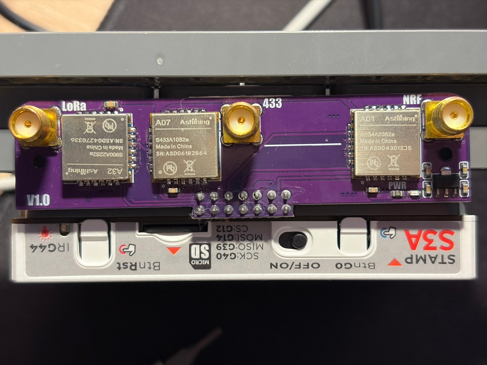
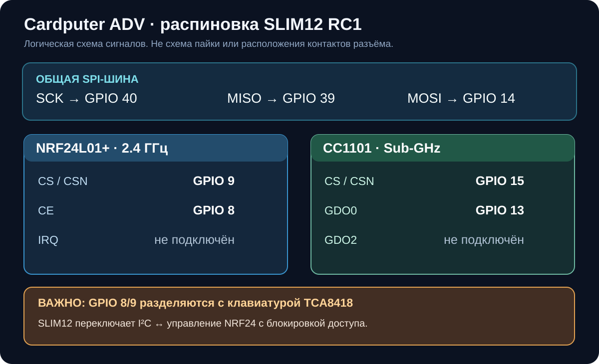
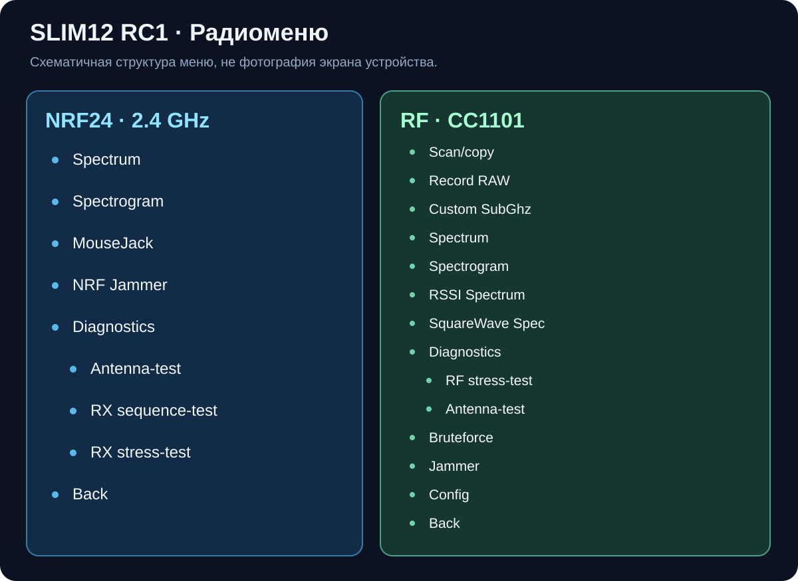

# Bruce SLIM12 RC1 — Cardputer ADV · NRF24 + CC1101

**Модифицированная прошивка Bruce 1.16.1 для M5Stack Cardputer ADV с внешней платой радиомодулей.** Главное отличие от обычной Bruce — **другая распиновка NRF24L01+ и CC1101**, поддержка совместного использования GPIO с клавиатурой ADV и дополнительные инструменты сканирования, визуализации и диагностики.

> [!IMPORTANT]
> **Это не универсальная прошивка для любого Cardputer или любого расширения.** Она рассчитана на **M5Stack Cardputer ADV** и конкретную схему подключения, приведённую ниже. Перед установкой убедитесь, что контакты вашей платы совпадают. Другие ревизии модуля могут иметь иную разводку.

**Модуль / карточка товара:** [Комплектующие M5Stack CardputerStamp — Ozon](https://www.ozon.ru/product/komplektuyushchie-m5stack-cardputerstamp-4568233782/). На маркетплейсе могут предлагаться разные комплектации и ревизии: ориентируйтесь на **физическую маркировку платы и таблицу GPIO**, а не только на название товара.



*Фотография используемой платы расширения. На ней видны секции **LoRa / 433 / NRF**. В этой сборке основная поддержка сделана для **CC1101 (433 МГц)** и **NRF24 (2,4 ГГц)**. Секция LoRa на самой плате присутствует, но **пункт LoRa в данной SLIM-сборке отключён**.*

> [!IMPORTANT]
> Эта версия прошивки намеренно "обезжирена" для того, чтобы одновременно можно было установить как bruce, так и официальную прошивку для работы LoRa - **Cardputer Mesh Kit Meshtastic Firmware** (Meshtastic Firmware for Cardputer-Adv + Cap LoRa-1262).

## Чем SLIM12 отличается от стоковой Bruce

В стандартных исходниках Bruce 1.16.1 для Cardputer ADV радиомодули используют другие управляющие GPIO. Более того, в стоковом `boards/m5stack-cardputer/interface.cpp` пины могли **принудительно перезаписываться при инициализации**. SLIM12 изменяет значения по умолчанию и **не выполняет эту жёсткую перезапись**: сохранённая конфигурация `/brucePins.conf` остаётся приоритетной.

### Ключевые изменения распиновки

| Радиомодуль / сигнал | Стоковая Bruce 1.16.1 (фактическое назначение в `interface.cpp`) | **SLIM12 RC1** |
|---|---:|---:|
| **NRF24 — SCK** | GPIO 40 | **GPIO 40** |
| **NRF24 — MISO** | GPIO 39 | **GPIO 39** |
| **NRF24 — MOSI** | GPIO 14 | **GPIO 14** |
| **NRF24 — CSN / CS** | GPIO 6 | **GPIO 9** |
| **NRF24 — CE** | GPIO 4 | **GPIO 8** |
| **CC1101 — SCK** | GPIO 40 | **GPIO 40** |
| **CC1101 — MISO** | GPIO 39 | **GPIO 39** |
| **CC1101 — MOSI** | GPIO 14 | **GPIO 14** |
| **CC1101 — CSN / CS** | GPIO 13 | **GPIO 15** |
| **CC1101 — GDO0** | GPIO 5 | **GPIO 13** |
| **CC1101 — GDO2** | — | не используется (`-1`) |

Оба радиочипа используют **общую шину SPI** (`SCK=40`, `MISO=39`, `MOSI=14`), но **раздельные сигналы выбора CS**. В режиме работы NRF24 прошивка дополнительно переводит неактивный CC1101 в невыбранное состояние.



### Особенность Cardputer ADV: NRF24 и клавиатура делят GPIO 8/9

В Cardputer ADV контроллер клавиатуры **TCA8418** подключён к I²C по линиям:

- `GPIO 8` — `SDA` клавиатуры **и CE NRF24**;
- `GPIO 9` — `SCL` клавиатуры **и CSN NRF24**.

Это намеренная особенность данной конфигурации, **не рекомендация подключать произвольный NRF24 напрямую параллельно I²C без учёта схемы платы**. В SLIM12 включена адаптация `CARDPUTER_ADV_NRF_KB_MUX`: при работе с NRF24 программа переключает владение GPIO между `Wire1` (клавиатура) и радиочипом, использует блокировку FreeRTOS и возвращает линии клавиатуре после окончания радиооперации.

> [!WARNING]
> **Не используйте эту таблицу как универсальную электрическую схему монтажа.** Она отражает назначения GPIO в прошивке, а не физические номера контактов гребёнки, схему питания или внутреннюю коммутацию конкретной радиоплаты. При установке другого модуля проверьте его документацию и питание. NRF24 и CC1101 обычно требуют **3,3 В на входах питания и логики**; не подключайте 5 В непосредственно к выводам радиочипов.

Дополнительно `GPIO 13/15`, назначенные CC1101, пересекаются с возможными назначениями UART/GPS. Одновременная работа конфликтующих периферийных режимов не гарантируется.

## Настройка GPIO после установки

Новые значения находятся в `boards/m5stack-cardputer/m5stack-cardputer.ini` и применяются **при создании новой конфигурации**. Если на устройстве ранее сохранён `/brucePins.conf`, он может **переопределить** новые значения по умолчанию. Поэтому при обновлении со стоковой версии требуется проверить файл настроек.

Ожидаемые поля `CC1101_Pins` и `NRF24_Pins` в записи устройства:

```json
{
  "CC1101_Pins": {
    "sck": 40,
    "miso": 39,
    "mosi": 14,
    "cs": 15,
    "io0": 13,
    "io2": -1
  },
  "NRF24_Pins": {
    "sck": 40,
    "miso": 39,
    "mosi": 14,
    "cs": 9,
    "io0": 8,
    "io2": -1
  }
}
```

**Внимание:** показан **фрагмент** настроек, а не готовый полный `/brucePins.conf`. Настоящий файл содержит внешний JSON-объект с ключом устройства, а также другие поля. Не заменяйте весь файл этим примером. Редактируйте только два раздела и предварительно сделайте резервную копию настроек. В исходном проекте есть `custom-default-pins.json` с аналогичными значениями.

Для CC1101 выберите **`RF → Config → RF Module → CC1101`**, затем при необходимости установите RF Frequency на **433,92 МГц**. Прежде чем записывать сигналы, убедитесь, что подключена антенна соответствующего диапазона.

## Функции NRF24 · 2,4 ГГц



| Пункт | Что делает |
|---|---|
| **Spectrum** | Пассивно показывает активность по **84 каналам 2400–2483 МГц**; выделяет наиболее активную частоту и количество положительных окон RPD. |
| **Spectrogram** | Быстрый цветной частотно-временной «водопад» по выбранному диапазону 2,4 ГГц. Пресеты для Wi-Fi, BLE и других участков диапазона. |
| **MouseJack** | Инструменты исследования совместимых беспроводных HID-устройств в разрешённой тестовой среде. |
| **NRF Jammer** | Экспериментальный режим радиопередачи, способный создавать помехи. Не используйте его в публичном эфире или без соответствующего разрешения. |
| **Diagnostics → Antenna-test** | Пассивный сравнительный тест активности RPD на 2412 / 2437 / 2462 МГц. |
| **Diagnostics → RX sequence-test** | Серия циклов инициализации → RX → остановки NRF24 с проверкой регистров, SPI и отсутствия неожиданных переходов. |
| **Diagnostics → RX stress-test** | Продолжительное наблюдение на фиксированной частоте, повторная инициализация примерно каждые 20 секунд, события «тишины» и ошибки в Serial. |

**Точность измерений:** NRF24 фиксирует превышение порога **RPD**, а **не декодирует Wi-Fi-пакеты**, не отображает калиброванный RSSI в dBm и не измеряет реальное усиление антенны в dBi.

## Функции RF · CC1101 / Sub-GHz

| Пункт | Что делает |
|---|---|
| **Scan/copy** | Поиск/чтение поддерживаемых RF-протоколов, сохранение и воспроизведение захваченных сигналов своего оборудования. При успешном захвате — звуковое уведомление. |
| **Record RAW** | Запись временной последовательности импульсов без обязательного распознавания протокола. |
| **Custom SubGhz** | Ручная настройка/отправка пользовательского Sub-GHz сигнала. |
| **Spectrum** | Частотный обзор по RSSI в диапазоне **390–450 МГц**, шаг 500 кГц, с выделением выраженного пика. Обновление столбцов без полной очистки экрана. |
| **Spectrogram** | Водопад RSSI с пресетами **300–440, 300–348, 387–464, 390–450, 433–435, 433,05–434,79, 315, 868 и 915 МГц** и режимами FAST/DETAIL. |
| **RSSI Spectrum** | Дополнительный/унаследованный график уровня RSSI. |
| **SquareWave Spec** | Анализ длительности высоких и низких импульсов (цифровой сигнал на выходе приёмника). |
| **Diagnostics → RF stress-test** | Длительный контроль RSSI, состояния RX, Carrier Sense, повторных инициализаций и подозрительно «плоского» уровня сигнала. |
| **Diagnostics → Antenna-test** | Сравнительные наблюдения RSSI на трёх частотах около 433 МГц. |
| **Bruteforce** | Перебор кодовых комбинаций; только на собственных тестовых устройствах и при наличии разрешения. |
| **Jammer** | Генерация радиопомех; не предназначено для использования без соответствующего разрешения. |
| **Config** | Выбор RF-модуля, частоты и настроек RF. |

**Аппаратные диапазоны CC1101:** **300–348**, **387–464** и **779–928 МГц**. При широком обзоре неподдерживаемые участки не должны трактоваться как частоты с нулевым сигналом. CC1101 — перестраиваемый **узкополосный** приёмник, а не полноценный SDR: очень короткие передачи могут быть пропущены при сканировании.

### FAST / DETAIL и пики спектра

- **FAST** — уменьшенное число точек, более короткая задержка измерения, более частое обновление водопада.
- **DETAIL** — больше точек и более длительное измерение, полезное для узких/кратковременных сигналов.
- Цвета водопада отражают **изменение измеренного RSSI относительно фонового уровня**, а не количество пакетов или точную спектральную плотность мощности.
- При почти неизменном RSSI показывается **`FLAT RSSI`**, без придуманного пика.

## Интерфейс, клавиатура, звук и светодиод

- **ESC / BACK (Backspace)** — выход из рабочих экранов и возврат к меню; сохранены существующие действия **NEXT** для доступа к настройкам программ.
- **Подсветка** удерживается включённой во время работы RF/NRF24, включая вложенные меню; обновления графиков сведены к изменившимся областям, чтобы уменьшить мерцание.
- **Звуковое уведомление** после успешного захвата в `RF → Scan/copy`, после получения команды в `IR → IR Read` и после чтения ключа с корректной CRC в `Others → iButton`. Требуется включить настройку **Sound**.
- **RGB LED / Breathe** — исправлены выбор цвета и повторная регистрация FastLED; анимация сглажена. Во время некоторых операций захвата через RMT анимация может **временно приостанавливаться** для предотвращения цветных вспышек.
- **Упрощённая конфигурация**: в данной SLIM-сборке из интерфейса удалены некоторые ненужные для проекта пункты, включая FM, LoRa и Ethernet; это **не утверждение**, что соответствующие аппаратные функции отсутствуют в Cardputer ADV.

## Сборка из исходников

**Платформа:** M5Stack Cardputer ADV (ESP32-S3), окружение PlatformIO: `m5stack-cardputer`.

Для сборки используйте **весь исходный проект SLIM12 RC1**:

```bash
python3 -m pip install --upgrade platformio
pio run -e m5stack-cardputer -t build-firmware
```

При необходимости очистить промежуточные артефакты:

```bash
pio run -e m5stack-cardputer -t clean
pio run -e m5stack-cardputer -t build-firmware
```

При успешной сборке объединённый образ загрузчика и приложения обычно записывается как `Bruce-m5stack-cardputer.bin`, а обычный `.pio/build/m5stack-cardputer/firmware.bin` представляет собой **только приложение**. Эти файлы не взаимозаменяемы при прошивке: способ записи и адрес зависят от типа образа.

В проекте имеется workflow `.github/workflows/build-cardputer-adv-custom.yml`, предназначенный для сборки через **GitHub Actions** (наличие workflow не является гарантией успешной компиляции на каждом обновлении зависимостей).

## Как проверить после прошивки

1. После запуска проверьте работоспособность клавиатуры Cardputer ADV, включая ESC/BACK.
2. Убедитесь в корректных GPIO в `/brucePins.conf`, затем откройте `NRF24 → Spectrum` и `NRF24 → Diagnostics`.
3. Проверьте `RF → Config → RF Module → CC1101`, затем `RF → Spectrum` и `RF → Spectrogram` на известном сигнале 433,92 МГц.
4. Отдельно протестируйте звук `Scan/copy`, `IR Read` и `iButton`, а также LED `Breathe` при переключении меню и работе радиомодулей.
5. Для Serial Monitor: `pio device monitor -b 115200` (с явным выбором порта при необходимости).

> [!NOTE]
> **SLIM12 имеет статус RC1.** По предыдущим тестам многократная переинициализация NRF24 выполнялась без цифровых ошибок. При этом в диагностике CC1101 наблюдался почти неизменный RSSI (`raw=F4`, около −80 dBm), и корректность приёма реального сигнала не следует считать подтверждённой только по наличию связи SPI. Полная сборка и все пользовательские сценарии именно этой RC1-ревизии требуют проверки на устройстве.

## Совместимость и важные ограничения

- Данная распиновка предназначена **для описанного внешнего радиорасширения Cardputer ADV**. Она **не идентична** конфигурации популярного другого dual-radio-модуля с `CC1101 CS=13/GDO0=5` и `NRF24 CS=6/CE=4`.
- Не переставляйте антенны местами: **433 МГц** для CC1101 и **2,4 ГГц** для NRF24. Не включайте передачу без подходящей антенны.
- Физически присутствующий на фотографии модуль LoRa **не поддерживается пунктом меню** в этой компактной ревизии.
- Работайте с записью, воспроизведением и передачей радиосигналов только на **собственных устройствах, в разрешённой тестовой среде и в пределах правил радиочастот вашего региона**. Особенно это относится к Jammer, MouseJack и Bruteforce.

## Благодарности и лицензия

Основа: [Bruce Firmware](https://github.com/BruceDevices/firmware), версия **1.16.1**. Эта сборка — **независимая модификация**, не официальный релиз Bruce. Исходный проект распространяется под **GNU AGPL-3.0**; сохраняйте `LICENSE`, соответствующие уведомления об авторстве и выполняйте требования лицензии при распространении исходного кода и бинарников.

Полезные справочные материалы: [Bruce Wiki — Cardputer ADV / CC1101 и NRF24](https://wiki.bruce.computer/wiring-diagrams/cardputer-adv/cc1101-nrf24/), [Texas Instruments — CC1101](https://www.ti.com/product/CC1101), [товар на Ozon](https://www.ozon.ru/product/komplektuyushchie-m5stack-cardputerstamp-4568233782/).
